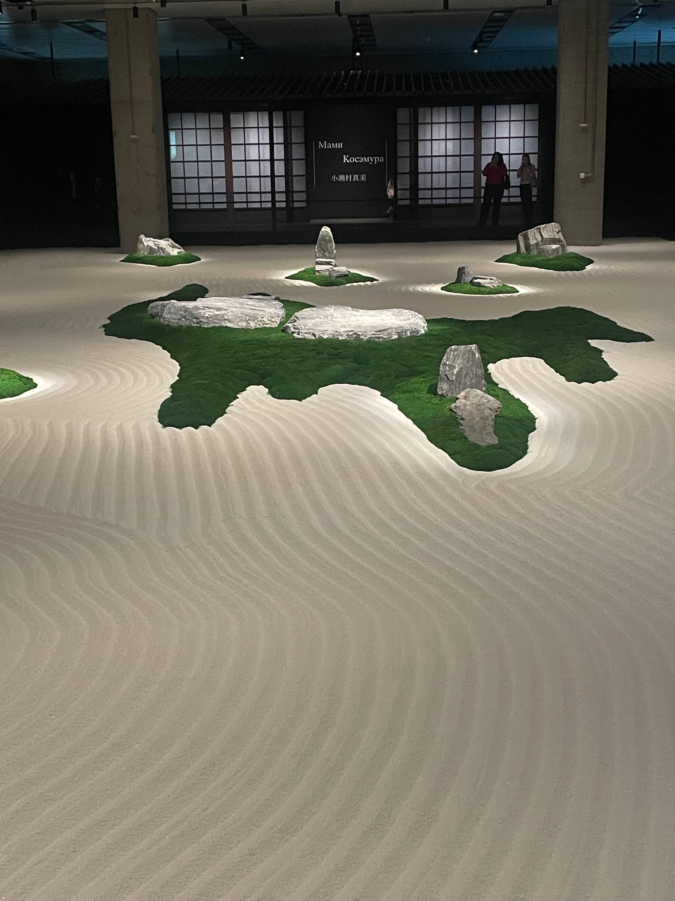
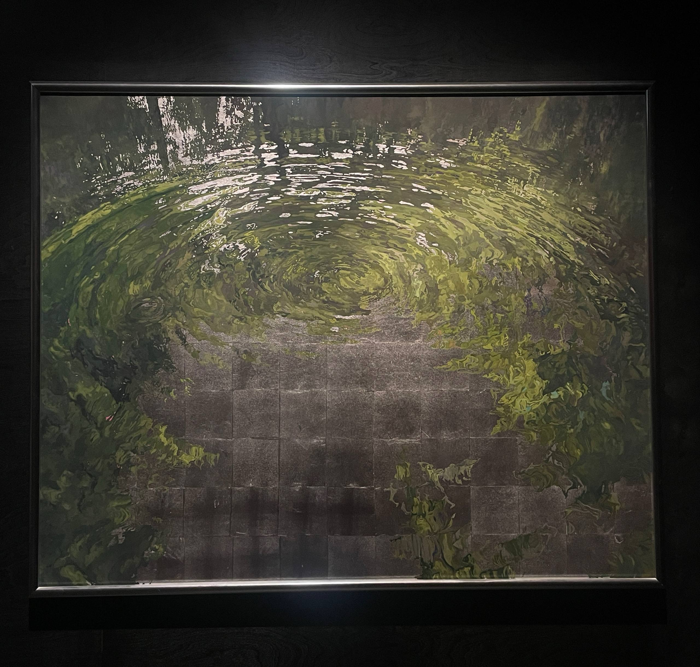
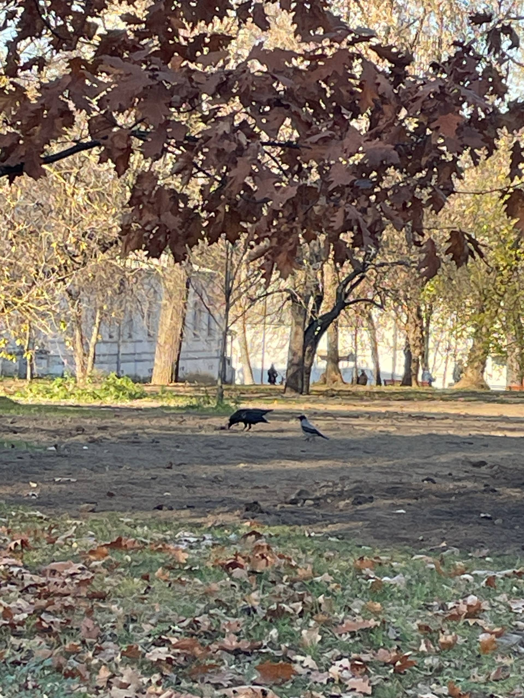

# Setup and Run Instructions
## Operating System
The code was tested in **Ubuntu on Windows Subsystem for Linux (WSL)**.
## Requirements
*Conda
*Python 3.14
## Installation
1. Create a Conda environment
2. Activate the environment
3. Install Python 3.14 `conda install python=3.14`
4. Install pip `conda install pip`
5. Install pandas `conda install pandas`
6. Install the Google API Core package `pip install google-api-core`
7. Install OpenCV `pip install opencv-python`
8. Install Biopython `pip install biopython`
9. Install PyArrow `conda install -c conda-forge pyarrow`
## Additional Biopython Setup
The script uses Bio.SubsMat, which is not included in recent Biopython versions. 
1. Create the required directory `mkdir -p "$CONDA_PREFIX/lib/python3.14/site-packages/Bio/SubsMat"`
2. Create the MatrixInfo.py file `nano "$CONDA_PREFIX/lib/python3.14/site-packages/Bio/SubsMat/MatrixInfo.py"`
3. Add the following code:
```from Bio.Align import substitution_matrices
blosum62 = substitution_matrices.load("BLOSUM62")```
4. Save the file by pressing Ctrl + O, then Enter, and exit with Ctrl + X.
## Run
`python pain.py`
## Execution Result
The script starts running but stops at line 46 with the following error:
`ValueError: index cannot be a set`

# Дополнительное задание
На этой неделе я постаралась взять паузу, чтобы разгрузить голову, правда теперь из-за этого делаю ДЗ в последний день до дедлайна...
* Встретилась с друзьями, которых давно не видела
* Гуляла по усадьбе Измайлово в последние солнечные дни осени
* Наблюдала за воронами, которых первый раз увидела в Москве
* Ела вкуснейшую кавказскую еду
* Ходила на выставку, посвященную японской культуре МА. Вся экспозиция отражает философию слова МА - паузы или пространства между чем-либо (словами, звуками, вдохами, предметами и т.д.). Почувствовала это самое МА, смотря на сад камней.
Фотоотчет:



   
