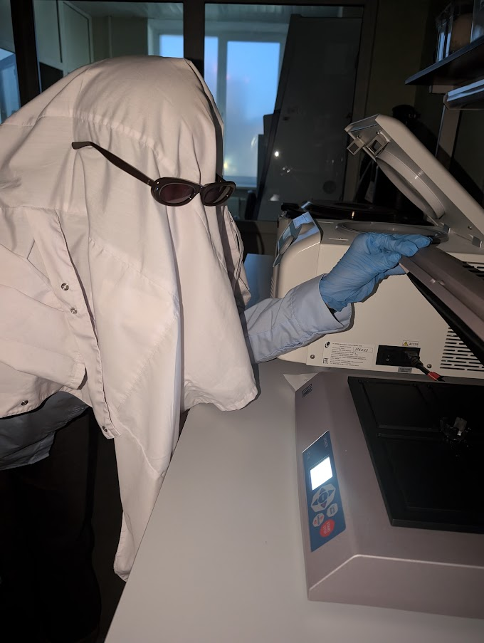

# HW 6. Virtual environments
## Part 1.
The code was run on Ubuntu 26.04 LTS in WSL 2 under Windows 11. Python version: 3.15.2.

I'm not sure how far back I should start, so I'll start from the very beginning, assuming that mamba is already installed on your machine. Enter all commands in the terminal.

1. Clone the repository to your machine via SSH (use a password-protected SSH key):

`git clone git@github.com:mrsnightkin/HW6_venv.git`

2. Navigate to the HW6_venv project folder, which contains the pain.py script and the environment.yaml file (run this from the directory where you cloned the repository).

`cd ./HW6_venv`

3. Create a virtual environment in mamba named HW_env (you can change the name if necessary) and install all the required packages from environment.yaml:

`mamba create -n HW_env -f environment.yaml`

3.1. (Confirm the changes by typing y and pressing Enter.)

4. Once the installation is complete, activate the environment:

`mamba activate HW_env`

Since the Bio.SubsMat package we need is only available in an older version of Biopython, which is incompatible with newer Python versions (and we cannot downgrade Python because of another library), we will copy the required package into the current Biopython installation.

5. Download the .tar.gz archive of the older version (biopython-1.79):

`wget https://biopython.org/DIST/biopython-1.79.tar.gz`

6. Extract only the SubsMat package from the archive:

`tar -xzf biopython-1.79.tar.gz biopython-1.79/Bio/SubsMat`

7. Run a short Python command to find where Biopython is installed inside the virtual environment (import Biopython, print the path to its package directory, and store the output in a variable).

`bio_dir=$(python -c "import Bio; print(Bio.__path__[0])")`

8. Copy the entire SubsMat folder (including all subfolders), using its path relative to the current directory, into the main Biopython folder in our virtual environment.

`cp -r biopython-1.79/Bio/SubsMat "$bio_dir/"`

8.1 *You can delete the archive and the extracted folder to keep things tidy (optional):*

`rm biopython-1.79.tar.gz`

`rm -r biopython-1.79`

Now we need to deal with the line pd.DataFrame([1, 2, 3, 4], index={1, 2, 3, 4}): the script passes the index as a set, but pandas doesn't get it, so we need to make it get it.

9. Run another short Python command to store the path to the pandas source file that handles DataFrames in a variable.

`frame_file=$(python -c "import pandas.core.frame; print(pandas.core.frame.__file__)")`

9.1. Before editing pandas, create a backup of the original file.

`cp "$frame_file" "$frame_file.bak"`

10. Open the file in the nano editor.

`nano "$frame_file"`

The source file will open.

Press Ctrl+W to open the search prompt, type
`raise ValueError("index cannot be a set")`, and press Enter to find this line in the file.

Delete this line and replace it with `index = list(index)` (now we'll make it accept sets as indices, hehe).
**It is very important to preserve the indentation.**

Then save with Ctrl+O, Enter, and exit nano with Ctrl+X.

You can now run the script:

`python pain.py`

Hooray! Victory! I hope these instructions worked for you too.

PS: Before removing or recreating the environment, restore the original pandas file. Manual changes can also affect future environments (This happened to me, and I experienced pain). Run these commands while the environment is still active.

`frame_file=$(python -c "import pandas.core.frame; print(pandas.core.frame.__file__)")`

`cp "$frame_file.bak" "$frame_file"`

## Part 2.

I had a really good rest during this week of chilling out—a breath of fresh air for the first time in two months. I went on lots of walks, hit the gym twice, ate khinkali, played Skyrim, and filmed a Halloween reel with my colleagues. Proof attached!

