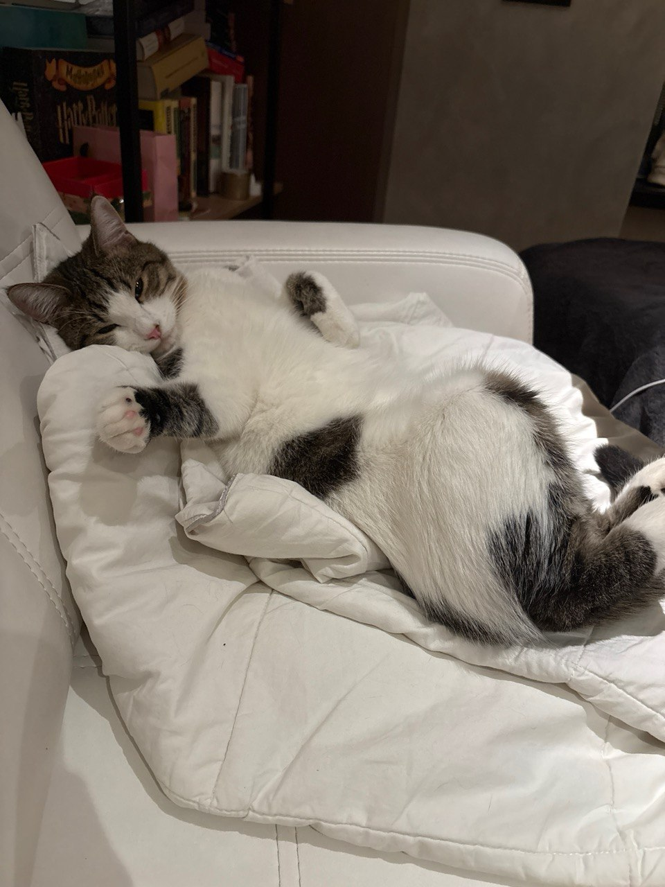

# HW6: Virtual Environments

## Overview

The project was tested on **macOS 26.6.2 (Intel, x86_64)** using Conda 24.11.0.

Python version: 3.14.

## Create and activate environment

Create the Conda environment using the provided configuration file:

```bash
conda env create -f environment.yml
conda activate pain-env
```

## Biopython version 

The original script imports `Bio.SubsMat.MatrixInfo`, which is no longer available in modern Biopython versions (it was removed in Biopython 1.80).

To restore this module, download the required files from Biopython 1.79 into the installed Biopython package:

```bash
# Find the Biopython installation directory
BIO_PATH=$(python -c "import Bio; print(Bio.__path__[0])")

# Create the missing SubsMat directory
mkdir -p "$BIO_PATH/SubsMat"

# Download the required files from Biopython 1.79
BASE_URL="https://raw.githubusercontent.com/biopython/biopython/biopython-179/Bio/SubsMat"

curl -fL "$BASE_URL/__init__.py" -o "$BIO_PATH/SubsMat/__init__.py"
curl -fL "$BASE_URL/MatrixInfo.py" -o "$BIO_PATH/SubsMat/MatrixInfo.py"
curl -fL "$BASE_URL/FreqTable.py" -o "$BIO_PATH/SubsMat/FreqTable.py"
```

## Pandas index handling

The original script passes a Python `set` as the index argument to `pd.DataFrame()`. Pandas does not accept sets as indices because they are unordered collections.

To resolve this issue, the pandas source code is patched to convert the set into a sorted list.

```bash
# Find the pandas source file
PANDAS_FILE=$(python -c "import pandas.core.frame as f; print(f.__file__)")

# Replace the error with a conversion to a sorted list
python - "$PANDAS_FILE" <<'PY'
from pathlib import Path
import sys

path = Path(sys.argv[1])
code = path.read_text()

old = 'raise ValueError("index cannot be a set")'
new = 'index = sorted(index)'

if old not in code:
    raise SystemExit("The target code was not found.")

path.write_text(code.replace(old, new))
print("Pandas compatibility patch applied.")
PY
```

## Run the script

```bash
python pain.py
```

## Rest

There was no rest! Only the cat was resting (and I was with him a little).


