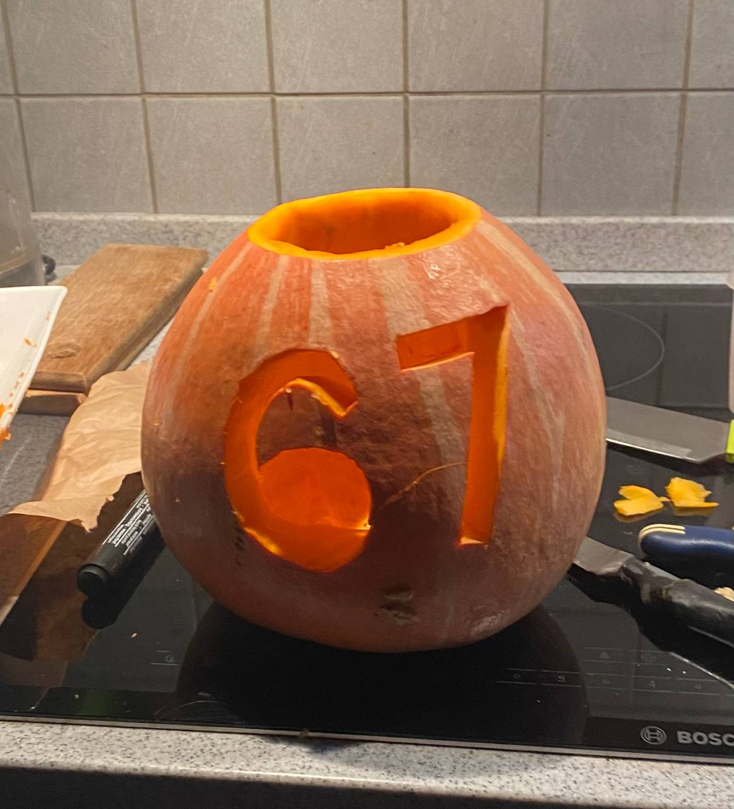

# Step-by-step instructions on how to run pain.py

1. Create and activate mamba environment
```bash
mamba create -n pain python=3.14.10
mamba activate pain
```
2. Install all the nessesary packages 
```bash
pip install google-api-python-client==2.201.0
mamba install pandas==3.1.0
pip install opencv-python==5.0.0.93
mamba install -c conda-forge biopython
mamba install -c conda-forge "pyarrow>=16"
```
3. Resolve the Bio.SubsMat conflict

The problem is that the new versions of biopython no longer have the SubsMat module, and the old versions of biopython on Python 3.14 are not installed. Therefore, we need to take the real SubsMat module from the official release of biopython 1.79 and put it inside the installed biopython.

a) Download the biopython 1.79 sources and unpack them (or you can just download the "biopython-biopython-179" folder from this repo)
```bash
wget https://github.com/biopython/biopython/archive/refs/tags/biopython-179.tar.gz
tar -xzf biopython-179.tar.gz
```
b) Copy the SubsMat folder to the installed biopython

'$BIO_DIR' - the path to the biopython folder in your environment. It should something look like : ../envs/pain/lib/python3.14/site-packages/Bio
```bash
cp -r biopython-biopython-179/Bio/SubsMat $BIO_DIR
```
4. Resolve the pandas conflict 

There is a similar conflict with pandas as with Bio.SubsMat - it is necessary to roll back to an older version in order for the code to run. You have to open and edit the **frame.py** file. It is handy to do it in Positron. 

'$PATH_TO_FRAME.PY'- the path to the frame.py folder in your environment. It should something look like : ../envs/pain/lib/python3.14/site-packages/pandas/core/frame.py

```bash
positron '$PATH_TO_FRAME.PY'
```
Next you need to find these lines (lines 506-507) in the file and comment them: 
```bash
if isinstance(index, set):
    raise ValueError("index cannot be a set")
```
5. Enjoy! 


P.S. how I chilled out this week - I made my own eye of Sauron costume and celebrated Halloween with friends


