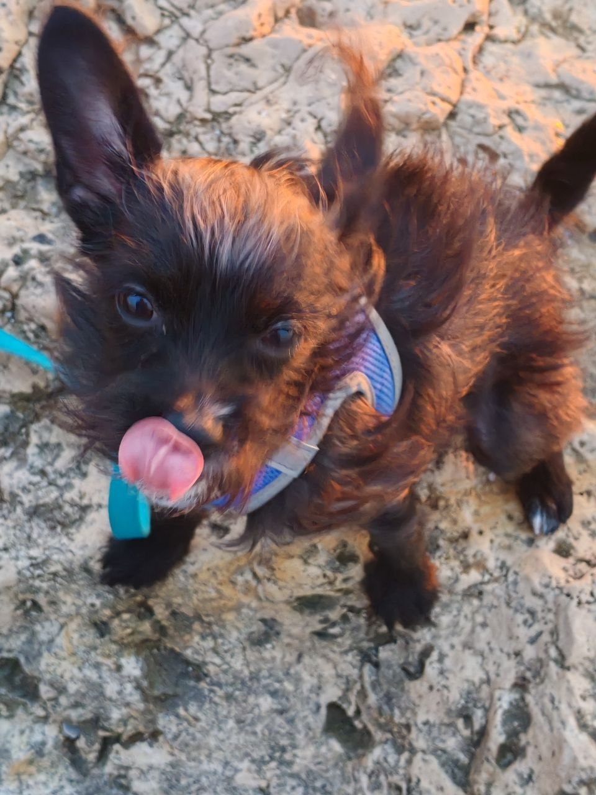

# Running `pain.py`

This repository provides a reproducible environment for running `pain.py`.

## Prerequisites

- [Conda](https://docs.conda.io/projects/conda/en/stable/) installed.
- Windows (PowerShell) or Linux (Bash).
- Internet access.

## Package contents

pain.py — the original Python script.

environment.yaml — Conda environment configuration with the required dependencies and their versions.

compart_fix.py — a script that applies compatibility fixes to Biopython and pandas.

README.md — instructions for installing the dependencies and running the script.

## Installation

0. Open a terminal in the repository directory.

1. Create the environment using environment.yaml and activate it

```bash
conda env create -f environment.yaml -n pain
```

```bash
conda activate pain
```

Apply the compatibility fixes:

```bash
python compart_fix.py
```

A successful run prints the message "Compatibility fixes applied".

2. Run the original script:

```bash
python pain.py
```

A successful run prints the message "Всё работает, ты большой молодец".

## Dependencies

All required package versions are specified in `environment.yaml`.

- Python 3.14.10
- pandas 3.1.0
- Biopython 1.88
- OpenCV 5.0.0
- PyArrow 26.0.0
- google-auth 2.62.0 

## Compatibility fixes

The `compart_fix.py` script performs two operations:

1. Restores `Bio.SubsMat.MatrixInfo` from Biopython 1.79 (this module was removed in later versions).
2. Modifies the installed pandas module to make the integer set usable as a DataFrame index.


## Notes

The solution was tested on Windows and Linux. Other operating systems have not been tested.

## Часть 2.

Это задание очень удачно совпало с относительно облегченной неделей на курсе. Иначе я бы не справилась. А так, мне удалось целых два раза сходить на море. Кажется, что это скучный отдых, но это ровно столько раз, сколько я была на море за всю весну и лето. Кроме того, на этой неделе я, наверное в первый, ну, может, во второй, раз в жизни, участвовала в выборах с реальным выбором. Считаю это тоже отдыхом, каким-то, моральным что ли.





