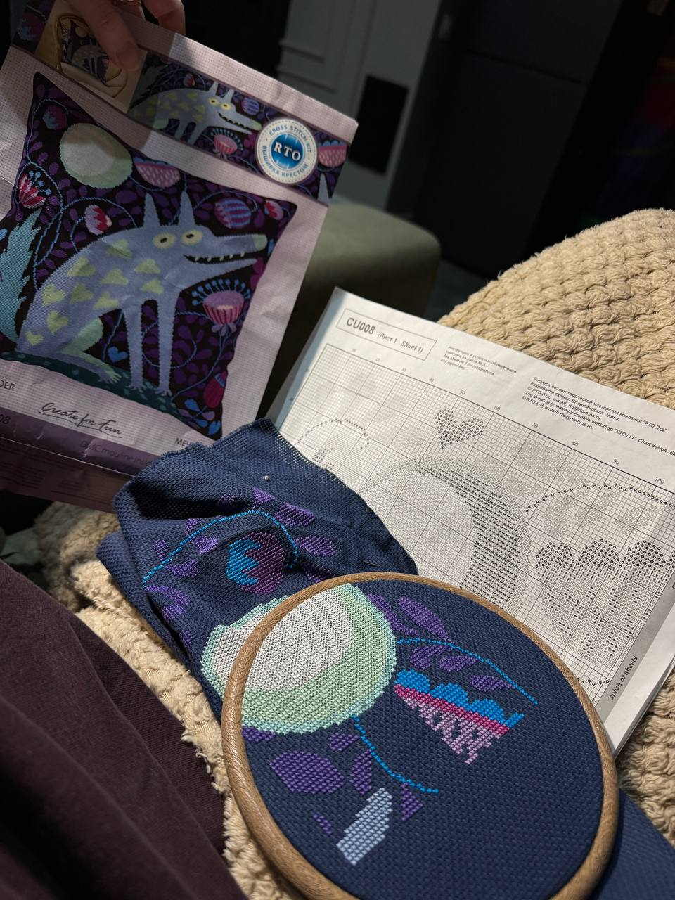

# HW6 Virtual environment set up

This repository contains tormentor `pain.py` script and the environment needed to run it.

This README explains how to run it and some compatibility fixes needed for that.

## Project structure

It is crucial to keep environment.yml, google.py, sitecustomize.py and setup.sh in one directory with pain.py. Overall project structure should look like this:

```text
HW6_venv/
├── pain.py
├── ultrapain.py
├── HW6_venv.md
├── README.md
├── environment.yml
├── google.py
├── sitecustomize.py
├── setup.sh
└── photo.jpg
```
Files added or modified by me:
- `README.md` describes the environment setup and how to run the script using it.
- `environment.yml` lists needed packsges to set up the environment.
- `google.py` is a tiny local fix for an imported module that the script does not actually use.
- `sitecustomize.py` applies two compatibility fixes at Python startup.
- `setup.sh` copies `sitecustomize.py` into the active environment's `site-packages`.
- `photo.jpg` this is how I chill 😊

## Requirements

- Conda
- A platform supported by the packages in `environment.yml`
- Python 3.14.10

Python 3.14.10 is intentional as the pain.py uses `annotationlib` feature requiring 3.14+ Python version.

## Setup and run

### 1. Create and activate the environment

Open a terminal in the project directory and run the following commands:

```bash
conda env create -f environment.yml
```

Activate it:

```bash
conda activate pain-env
```

### 2. Install the compatibility fix file

Run:

```bash
bash setup.sh
```
This script copies `sitecustomize.py` from the project directory into the active Conda environment's `site-packages` directory. Python automatically imports `sitecustomize` at start when it is present.

The copy is necessary because Conda does not automatically install project helper files listed beside `pain.py`. The original `sitecustomize.py` stays in the repository as the source file, while the copy inside `site-packages` is the version Python loads.

### 3. Run the script

Make sure you are still in the project directory and `pain-env` is active:

```bash
python pain.py
```
The script should finish and print sparkle and heart symbols followed by a cute uplifting message.

## Helper files description

### `google.py`

The original script contains:

```python
import google
```
However, it does not use `google` anywhere else. Installing an unrelated package just to satisfy this unused import would add an unnecessary dependency.

The local `google.py` file is enough. When `python pain.py` is run from the project directory, Python searches that directory and finds the fix.

Keep `google.py` next to `pain.py`. It does not need to be copied into `site-packages`.

### `sitecustomize.py`

This file applies two small compatibility fixes needed to run the script.

**1. Biopython compatibility**

The script imports:

```python
from Bio.SubsMat import MatrixInfo as matlist
```
Bio.SubsMat is an old Biopython module that was removed in Biopython 1.88 that I used. The fix recreates the module, adds the BLOSUM62 substitution matrix, and registers it in Python's module system (sys.modules) to support the original import in pain.py.

**2. Pandas compatibility**

The script creates a DataFrame using a set as its index:

```python
pd.DataFrame([1, 2, 3, 4], index={1, 2, 3, 4})
```

Pandas rejects sets as indexes because sets do not have a guaranteed order. The patch converts a set passed as `index` into a sorted list before calling the original DataFrame constructor.

These patches let the original script run smoothly.

## Errors that occured during virtual environment set up

| Error or issue | Why it happened | Fix |
|---|---|---|
| `No module named 'annotationlib'` | `annotationlib` is part of the Python 3.14 standard library | Used Python 3.14.10 |
| `No module named 'google'` | The script imports `google`, but does not use it | Created `google.py` next to `pain.py` |
| `No module named 'Bio.SubsMat'` | Biopython 1.79 which has this module is incompatible with Python 3.14.10 that I decided to use, so I unstalled Biopython 1.88 | The error is fixed by the code in `sitecustomize.py` module installed in the environment's `site-packages` |
| `ValueError: index cannot be a set` | Pandas does not accept a set as a DataFrame index | The error is fixed by the code in `sitecustomize.py` module installed in the environment's `site-packages`|

## Additional notes

The tested setup used macOS 26.7.1 on Apple Silicon (ARM64). 

### Отдых)))
Люблю зауютиться под пледом и вышивать. Сейчас вышиваю декоративную наволочку на подушку со смешным волком!


